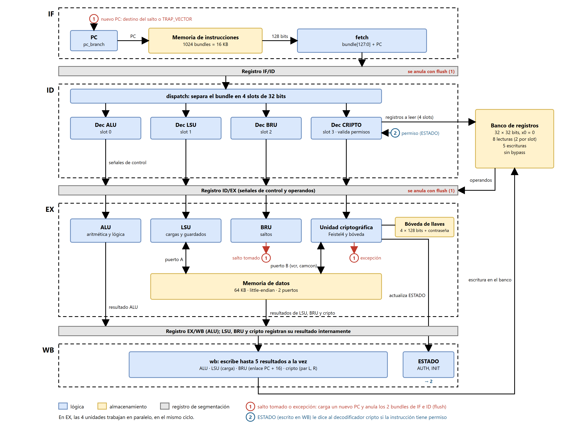

# Organización interna (microarquitectura) — Proyecto Grupal 1

> Archivo: `docs/microarchitecture.md`  
> Curso: CE4301 – Arquitectura de Computadores I, II Semestre 2026  
> Profesor: Dr.-Ing. Jeferson González Gómez  
> Entrega: Implementación Funcional (Entrega 2, 14 de octubre de 2026).  
> Equipo: Dylan Guerrero González, José García Izaguirre, Javier Hernández Castillo, Alejandro Vásquez Oviedo, Fabricio Mena Mejia  
> Alcance: Este archivo describe cómo se implementa la ISA documentada en [`isa.md`](isa.md) en términos de:
>
> - diagrama de bloques del procesador,
> - datapath segmentado (pipeline IF / ID / EX / WB),
> - dispatch paralelo de los slots del bundle hacia sus unidades funcionales,
> - interfaces hardware de cada unidad funcional (ALU, LSU, BRU, unidad criptográfica, bóveda de llaves),
> - banco de registros y memoria,
> - política de hazards (no hay forwarding, scoreboarding ni stalls) y excepción de privilegio.
>
> Las decisiones de qué ejecuta cada instrucción (tipo, IDs, operandos, semántica) viven en `isa.md`. Las decisiones de cómo se ejecutan en hardware viven aquí.

---

## Diagrama de organización de la arquitectura

### Descripción narrativa del pipeline

El procesador VLIW propio se organiza como un pipeline clásico de cuatro etapas — *Fetch → Decode/Dispatch → Execute → Writeback* — con registros de segmentación (`pipeline_if_id`, `pipeline_id_ex`, `pipeline_ex_wb`) que permiten que bundles distintos se encuentren simultáneamente en etapas distintas. Cada bundle de 128 bits (4 slots de 32 bits) viaja de forma atómica por las cuatro etapas; los slots se despachan en paralelo dentro de cada etapa hacia su unidad funcional asignada. No hay etapa MEM: la memoria de datos se accede dentro de EX.

#### Etapa IF (Instruction Fetch)

- El PC (32 bits, alineado a 16 bytes) apunta al bundle actual en la memoria de instrucciones. Después del reset vale `0x0000`.
- La memoria de instrucciones se lee de forma combinacional (`fetch` no agrega otro registro): en el mismo ciclo, el registro IF/ID captura los 128 bits del bundle (`bundle[127:0]`) junto con su `PC`.
- El PC avanza 16 bytes por ciclo (`pc_branch`), salvo que un salto tomado o una excepción lo carguen con otra dirección.
- Esta es la única etapa que toca la memoria de instrucciones.

#### Etapa ID (Decode / Dispatch)

`dispatch` separa el bundle en sus cuatro slots y cada uno se decodifica en paralelo, con un decodificador fijo:

- Slot 0 → `Dec ALU` (`decoder_alu`)
- Slot 1 → `Dec LSU` (`decoder_lsu`)
- Slot 2 → `Dec BRU` (`decoder_bru`)
- Slot 3 → `Dec CRIPTO` (`decoder_crypto`)

Cada decodificador reconoce el TIPO de 7 bits y el ID de 4 bits, y produce las señales de control internas para su unidad funcional. Si `TIPO = 0000000` (no utilizado por ninguna unidad activa), el decodificador lo marca como NOP y la unidad funcional no se invoca. El mismo patrón funciona en los cuatro slots: no hay campo de selección de unidad funcional porque la asignación slot→FU es fija por construcción.

A continuación se hace la lectura de registros. El banco de registros expone 8 puertos de lectura (4 slots × 2 lecturas por slot) para que cada slot pueda leer sus operandos fuente `rf1` y `rf2` en un solo ciclo, sin contención con los demás slots.

> El banco de registros no tiene bypass: una lectura en el mismo ciclo de la escritura entrega el valor anterior. Por eso el valor que escribe el bundle N lo puede leer el bundle N+3 o uno posterior; los bundles N+1 y N+2 todavía leen el valor anterior. Dentro de un bundle, todos los slots leen sus operandos antes de que se escriba cualquier resultado del mismo bundle.

En esta etapa también se valida el tipo de instrucción cripto contra el registro `ESTADO` (flecha "Valida el tipo de instrucción" del diagrama): `decoder_crypto` marca la instrucción si no tiene permiso, y esa marca viaja por ID/EX hasta EX (ver [Excepción de privilegio](#excepción-de-privilegio)).

Las señales decodificadas y los operandos leídos se guardan en el registro ID/EX. Las unidades de EX toman todo de ID/EX: en ese ciclo las lecturas del banco ya corresponden al bundle siguiente.

#### Etapa EX (Execute)

Las cuatro unidades funcionales operan en paralelo sobre los operandos leídos en ID:

- ALU: suma, resta, AND, OR, XOR, desplazamientos, comparaciones, en formato registro e inmediato. El inmediato de 11 bits se extiende con signo justo antes de la ALU.
- LSU: `cargai`, `cargabai`, `guardap`, `guardab` — accede al puerto A de la memoria de datos de 64 KB. `decoder_lsu` entrega una señal `valid` que sólo vale 1 si el slot 1 trae una instrucción LSU; así un NOP (cuyo código interno coincide con el de `guardap`) no escribe la memoria.
- BRU: `igualsi`, `igualno`, `menora`, `mayoroigual`, `sye`, `syer` — evalúa la condición y calcula el próximo PC (`target_pc`). Si el salto se toma activa `branch_flush`, que anula los bundles que están en IF e ID y carga el PC con el destino. `sye` y `syer` además guardan el enlace `PC + 16` en `rg`. La estrategia frente a saltos se documenta en [`isa.md`](isa.md#estrategia-frente-a-saltos), sección *Estrategia frente a saltos*.
- Unidad criptográfica: `fsl`, `fsli`, `ell`, `vcr`, `camcon`, `setpwd` — realiza una ronda de Feistel4 o una operación sobre la bóveda de llaves, según el ID. `vcr` y `camcon` leen o escriben la memoria de datos por su puerto B, así que pueden ir en el mismo bundle que una instrucción de la LSU.

La unidad criptográfica es la única con acceso a la bóveda de llaves (4 llaves × 128 bits + contraseña de 32 bits). La bóveda se escribe al final de EX (`ell`, `setpwd`, `camcon`), de modo que la instrucción cripto del bundle siguiente ya ve el cambio. Ningún slot de otra unidad funcional puede leer ni escribir la bóveda.

#### Etapa WB (Writeback)

- La ALU llega a WB a través de `pipeline_ex_wb`; la LSU, la BRU y la unidad criptográfica registran su resultado internamente, con la misma latencia.
- `wb` reúne los resultados de los cuatro orígenes posibles (ALU, LSU, BRU, unidad criptográfica) en los 5 puertos de escritura del banco, y se escriben simultáneamente en el flanco al final de la etapa.
- Para las instrucciones criptográficas que producen un par (L, R) de 64 bits, la escritura se reparte en dos registros consecutivos (`rd` y `rd+1`); por eso la cripto usa dos puertos.
- La palabra `ESTADO` (banderas `AUTH`, `INIT`) la mantiene la unidad criptográfica y se escribe al final de WB. No es accesible por instrucciones: sólo la modifican `vcr` y `setpwd`, y la lee el decodificador cripto en ID.

#### Política de hazards y sincronización

- Sin forwarding. No hay camino de datos que lleve un resultado de EX o WB hacia los operandos de ID, y el banco de registros no tiene bypass: la calendarización estática del compilador/ensamblador es quien evita los riesgos de datos, respetando la regla N+3. `tools/assembler.py` rechaza los programas que no la cumplen.
- Sin scoreboarding ni stalls. No hay detección dinámica de dependencias y el pipeline nunca se detiene.
- Sin conflictos estructurales entre slots. Cada slot tiene sus propios puertos de lectura (2) y de escritura (1, o 2 para la cripto), y la memoria de datos tiene un puerto para la LSU y otro para la cripto. Que dos unidades escriban el mismo registro en el mismo ciclo es un error de software: `wb` lo señala con `conflict` y gana el puerto de índice mayor (CRIPTO > BRU > LSU > ALU).
- Sin branch prediction ni delay slots escondidos. Un salto tomado anula los 2 bundles que están en IF e ID (penalización de 2 ciclos); uno no tomado no tiene penalización.

### Excepción de privilegio

`decoder_crypto` valida en ID cada instrucción cripto con el `ESTADO` de ese ciclo: `fsl`, `fsli`, `ell` y `camcon` necesitan `AUTH = 1` y `setpwd` necesita `INIT = 1`. Si no tiene permiso, al llegar a EX:

- se anula el bundle completo: no escriben la ALU, la LSU, la BRU ni la cripto, y el salto de la BRU no se toma;
- se anulan los 2 bundles que están en IF e ID, igual que en un salto tomado;
- el PC salta a `TRAP_VECTOR` = `0x3FF0`, el último bundle de la memoria de instrucciones, donde el programa debe tener su manejador;
- `trap_pc` guarda el PC del bundle que causó la excepción y `trap_count` cuenta las excepciones. Son registros sólo para observación: el ISA no define cómo leerlos ni cómo volver del manejador.

Como `ESTADO` se escribe en WB y se valida en ID, sigue la misma regla que los registros: después de `vcr`, la instrucción que necesita `AUTH = 1` va 3 bundles después.

### Banco de registros

- 32 registros de 32 bits, x0–x31.
- `x0` cableado a 0; las escrituras a `x0` se descartan.
- 8 puertos de lectura (4 slots × 2 operandos), combinacionales, y 5 puertos de escritura: uno por unidad funcional y uno extra para la segunda palabra del par de la cripto.
- Reset síncrono: todos los registros quedan en 0.
- Ver convención de uso (`x1`=ra, `x2`=sp, `x3`=gp, `x4–x15`=temporales, `x16–x31`=preservados) en [`isa.md`](isa.md#registros-de-propósito-general), sección *Registros de propósito general*.

### Memoria

- Memoria de instrucciones (`instruction_memory.sv`): `IMEM_BUNDLES` = 1024 bundles de 128 bits (16 KB), lectura combinacional. Arranca llena de NOP y se carga desde un archivo `.mem` con `$readmemh` (`+IMEM=<archivo.mem>`, formato de `tools/assembler.py`). El último bundle (`0x3FF0`) es `TRAP_VECTOR`.
- Memoria de datos (`memory.sv`): 64 KB (`DMEM_BYTES`), byte-direccionable, little-endian, lectura combinacional y escritura en el flanco. Es de doble puerto: el puerto A es de la LSU (con byte enables para `guardab`) y el puerto B de la unidad criptográfica (`vcr` y `camcon`). Se carga con `tools/load_file.py` (archivos a cifrar) y los resultados se extraen con `tools/extract_data.py`.
- Son dos espacios separados (arquitectura Harvard): el PC sólo direcciona la memoria de instrucciones y la LSU sólo la de datos.
- Ver mapa de memoria detallado en [`mapa_memoria.md`](mapa_memoria.md).

### Bóveda de llaves (vista hardware)

- 4 entradas × 128 bits = 4 llaves de Feistel4 (cada una particionada en 4 subllaves de 32 bits).
- Contraseña de 32 bits en una palabra separada, accesible únicamente por la unidad criptográfica.
- Banderas de `ESTADO`: `AUTH` (autenticación), `INIT` (modo provisionamiento, sólo `setpwd`). Están en `crypto_unit`, junto a la bóveda.
- Reset: la bóveda se borra completa, `AUTH = 0` e `INIT = 1`.
- Puertos hardware: exclusivamente lectura/escritura desde `crypto_unit.sv`. Sus únicas salidas son la subllave, que sólo entra al cálculo de la ronda, y la comparación de la contraseña. Sin ruta de escape hacia el banco de registros ni hacia la memoria de datos — el aislamiento entre bóveda y resto del sistema es estricto y se valida por testbench (`tb_key_vault.sv` y `tb_pipeline_cripto.sv`, ver [`simulation.md`](simulation.md)).

### Parámetros

`rtl/isa_defs.sv` concentra los parámetros de la organización: `NUM_SLOTS` = 4, `SLOT_W` = 32, `BUNDLE_W` = 128, `BUNDLE_BYTES` = 16, `IMEM_BUNDLES` = 1024, `DMEM_BYTES` = 65536 y `TRAP_VECTOR` = `(IMEM_BUNDLES − 1) × BUNDLE_BYTES`. Los módulos los usan en lugar de números fijos.

### Módulos SystemVerilog asociados

| Bloque del diagrama | Archivo principal |
|---|---|
| Fetch (IF) | `rtl/pc_branch.sv`, `rtl/instruction_memory.sv`, `rtl/fetch.sv`, `rtl/pipeline_if_id.sv` |
| Decode/Dispatch (ID) | `rtl/dispatch.sv`, `rtl/decoder_alu.sv`, `rtl/decoder_lsu.sv`, `rtl/decoder_bru.sv`, `rtl/decoder_crypto.sv`, `rtl/pipeline_id_ex.sv` |
| Execute (EX) | `rtl/alu.sv`, `rtl/lsu.sv`, `rtl/memory.sv`, `rtl/bru.sv`, `rtl/crypto_unit.sv`, `rtl/key_vault.sv` |
| Writeback (WB) | `rtl/pipeline_ex_wb.sv`, `rtl/wb.sv`, `rtl/regfile.sv` |
| Integración | `rtl/top.sv` (módulo principal) y `rtl/isa_defs.sv` (códigos del ISA y parámetros) |
| Banco de registros | `rtl/regfile.sv` (con `tb_regfile.sv` y `tb_regfile_pipeline.sv`) |
| Testbenches de unidad | `tb/tb_alu.sv`, `tb/tb_lsu.sv`, `tb/tb_bru.sv`, `tb/tb_crypto_unit.sv`, `tb/tb_key_vault.sv`, `tb/tb_memory.sv`, `tb/tb_wb.sv` y los de cada decodificador y registro de segmentación |
| Testbench de integración | `tb/tb_top.sv`, `tb/tb_pipeline_integracion.sv`, `tb/tb_pipeline_cripto.sv` |

> Versión diagramada: el diagrama de bloques de esta página corresponde a la versión consolidada del procesador VLIW del equipo, desarrollada en las branches `feat-Pipeline-ALU-RegFile`, `feat-LSU-BRU-Mem`, `feat-Pipeline-Cripto`, e integradas en `fix-Pipeline-Integracion`. Las branches históricas tempranas (`Pipeline`) tienen una versión más simple que aún no incluye la unidad criptográfica ni la BRU/LSU completas.
